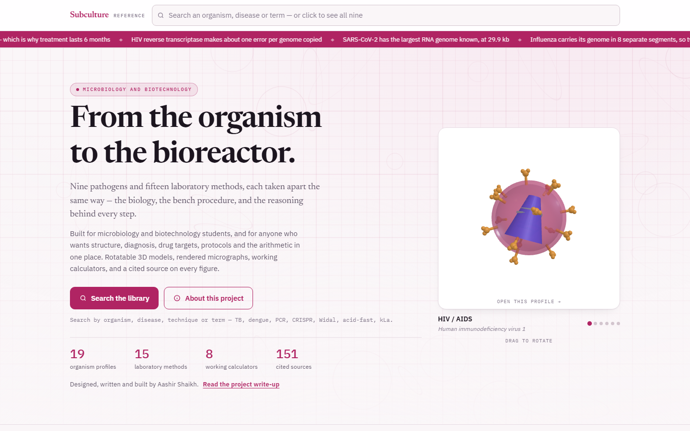
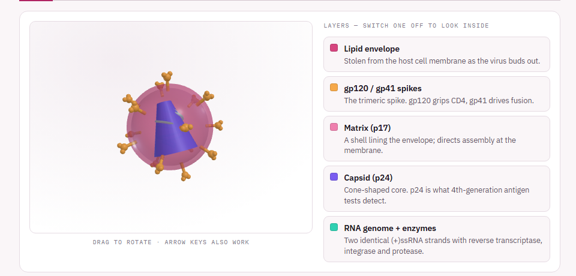
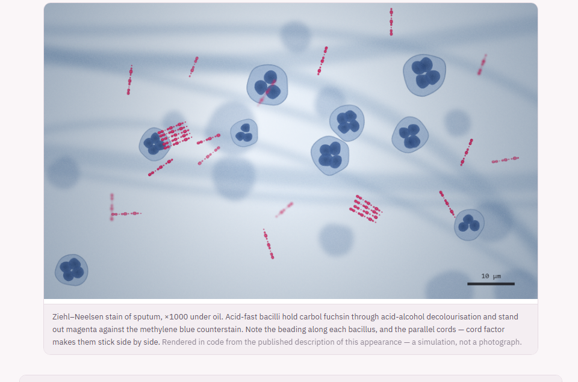
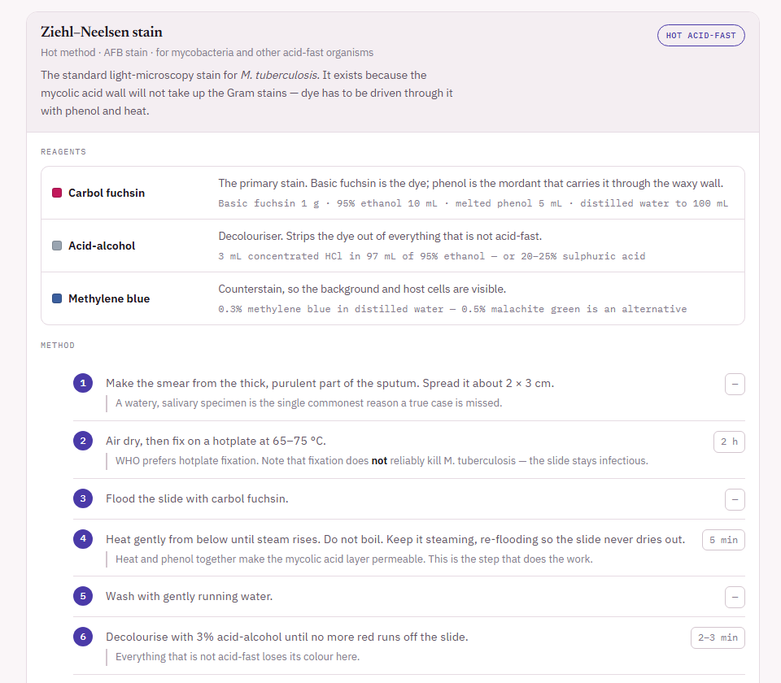
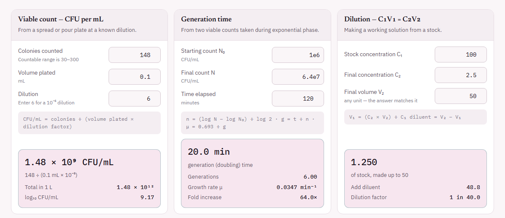

# Subculture

**From the organism to the bioreactor.** A microbiology and biotechnology study resource
for students: each pathogen and each lab method is taken apart the same way, covering the
biology, the bench procedure and the reasoning behind every step.

Designed, written and built by **Aashir Shaikh**.



| 19 | 15 | 10 | 8 | 21 |
|:-:|:-:|:-:|:-:|:-:|
| organism profiles | laboratory methods | staining protocols | calculators | rendered micrographs |

It is a single static page: no build step, no framework and no backend.

---

## What's inside

### Organism profiles

Viruses, bacteria, fungi and parasites, each with the same structure: classification and
history, structure and genome, replication or life cycle, transmission, pathogenesis,
clinical stages, diagnosis, treatment and drug targets, and prevention.

| Viruses | Bacteria | Parasites and fungi |
|---|---|---|
| HIV, COVID-19, influenza, hepatitis B, hepatitis C, dengue, rabies, measles, Ebola, Nipah | Tuberculosis, cholera, typhoid, *S. aureus*, *S. pyogenes*, *H. pylori* | Malaria, Leishmania, Candida |

### Interactive 3D models

Every organism has a parametric three.js model. You can drag it to rotate and switch
layers off one at a time to see what is inside, such as the envelope, spikes, capsid and genome.



### Rendered micrographs

Each micrograph shows how the organism actually looks under its stain: illumination
falloff, depth of field, stain granularity and a scale bar. They are drawn
procedurally in canvas, not photographed, and every caption says so.



### Lab methods and staining protocols

The methods cover culture, susceptibility testing, biochemical ID, sterilisation, growth curves,
biosafety, nucleic acid extraction, PCR, gels, cloning, ELISA, sequencing, protein
expression, CRISPR and fermentation. Each of the 10 staining protocols lists reagents with
their recipes, timed steps, the reason behind each step and common pitfalls.



### Calculators

The site has 8 working calculators for the arithmetic done at the bench: viable count (CFU/mL),
generation time, C₁V₁ = C₂V₂ dilutions, nucleic acid concentration and purity, primer
Tm (nearest-neighbour), malaria parasite density and more. Each one shows its formula
and flags values that should make you stop, such as a plate outside the countable range.



### Also included

- **HIV culture simulation**: a small lab game in which you grow a virus stock in PBMC culture.
- **Outbreak watch**: dated snapshots of current outbreaks, each linked to its source.
- **Search** across organisms, diseases, techniques and terms, for example "acid-fast", "Widal" or "kLa".
- **151 cited sources**, linked from the figures and statistics that use them.

---

## Opening it

**Quickest:** open `local.html` in any browser. It works straight from disk.

**With a local server** (needed only if your browser is strict about `file://`):

```bash
python3 -m http.server 8000
# then visit http://localhost:8000/local.html
```

An internet connection is required on first load, for three.js and the Google Fonts
stylesheet. Everything else is generated in code. The site uses no image or data files,
and the PNGs in `docs/screenshots/` are only for this README.

`index.html` is the source that gets published to the Claude Artifact platform, which
supplies the `<!doctype>`, `<html>`, `<head>` and `<body>` wrapper itself. That is why
`index.html` starts with `<title>` instead. `local.html` is the same file with that
wrapper added. Regenerate it after editing `index.html`:

```bash
python3 build-local.py
```

**Served by Frappe.** `frappe_app/subculture_site` is a small Frappe app that serves this site
at `/subculture`, alongside the author's other work on one site. It holds no content of its
own: `sync.py` copies `local.html` and the scripts into it. Run it after `build-local.py`:

```bash
python3 frappe_app/subculture_site/sync.py
```

---

## The files

| File | What it holds |
|---|---|
| `index.html` | Page shell, all CSS, top bar, search, footer, script tags |
| `app.js` | Router, the block renderer, search index, scroll spy, progress bar |
| `home.js` | Home page — hero, stats, outbreak watch, library tiles, about |
| `project.js` | Project write-up page |
| **Content** | |
| `data-core.js` | HIV, tuberculosis, COVID-19, influenza, hepatitis B |
| `data-more.js` | Dengue, malaria, cholera, typhoid |
| `data-virus2.js` | Rabies, hepatitis C, measles, Ebola, Nipah |
| `data-micro2.js` | *S. aureus*, *S. pyogenes*, *H. pylori*, Candida, Leishmania |
| `methods-micro.js` | Culture, susceptibility testing, biochemical ID, sterilisation, growth curve, biosafety |
| `methods-mol.js` | Nucleic acid extraction, PCR, gels, cloning, ELISA, sequencing, expression, CRISPR, fermentation |
| `stains.js` | 10 staining protocols — reagents, timed steps, mechanism, pitfalls |
| `outbreaks.js` | Outbreak watch entries, with the date each was checked |
| **Rendering** | |
| `models.js` | Parametric 3D organism models (three.js) |
| `micro.js` | Procedural micrographs (canvas 2D) — 21 scenes |
| `hero.js` | Hero backdrop: haemocytometer grid with drifting cells |
| `calc.js` | The 8 calculators |
| `game.js` | HIV culture simulation |

---

## How the content is structured

Every page — organism or method — is a plain object:

```js
{
  id: 'tb',
  name: 'Tuberculosis',
  organism: 'Mycobacterium tuberculosis',
  kind: 'bacterium',          // virus | bacterium | parasite | fungus | method
  aka: ['tb', 'koch bacillus', ...],   // search terms
  tagline: '...',
  hero: '...',
  quick: [['Label', 'Value'], ...],
  model: { ... },             // 3D model spec, optional
  sections: [
    { id: 'structure', title: 'Structure and genome', blocks: [ ... ] }
  ]
}
```

One generic renderer in `app.js` turns `blocks` into HTML. Adding an organism means
adding an object to a data file — no new page, no new markup.

### Block types

`p` · `ul` · `table` · `kv` · `steps` · `timeline` · `note` · `links` · `genome` ·
`organs` · `model` · `micro` · `protocol` · `chart` · `game`

A `protocol` block either names one from `stains.js` (`{t:'protocol', name:'gram'}`)
or defines one inline (`{t:'protocol', def:{...}}`).

---

## Adding things

**A new organism** — add an object to any `data-*.js` file. It appears in search,
in the chips and in all counts automatically.

**A new micrograph** — add a draw function and a registry entry in `micro.js`, then
reference it with `{t:'micro', kind:'your-key'}`.

**A new staining protocol** — add an entry to the `S` object in `stains.js`.

---

## Notes on the content

- The micrographs and 3D models are **generated in code**, not photographs. Each figure
  says so in its caption. They model the real optics of each modality — illumination
  falloff, depth of field, stain granularity, grain, scale bar — but they are
  simulations.
- The outbreak section is a **dated snapshot**, not a live feed. A published page cannot
  fetch other sites. Each card carries the date it was checked and a link to the source.
- Case numbers, resistance rates and breakpoints change yearly. Every statistic carries
  a note to check the current source before presenting it.
- This is a **study resource, not clinical guidance**, and it is not peer reviewed.

---

## Licence and reuse

The written content and code are Aashir Shaikh's own work. Cited sources (WHO, CDC,
EUCAST, CLSI and others) are linked, not reproduced. No third-party images are included,
which is why every figure is drawn rather than copied.

---

## Contact

Questions, corrections or ideas are welcome. Microbiology content goes out of date, and if
you spot an error I'd like to fix it.

- **Email:** [aashirshaikh2004@gmail.com](mailto:aashirshaikh2004@gmail.com)
- **GitHub:** [open an issue](https://github.com/aashirshaikh1/subculture/issues)
